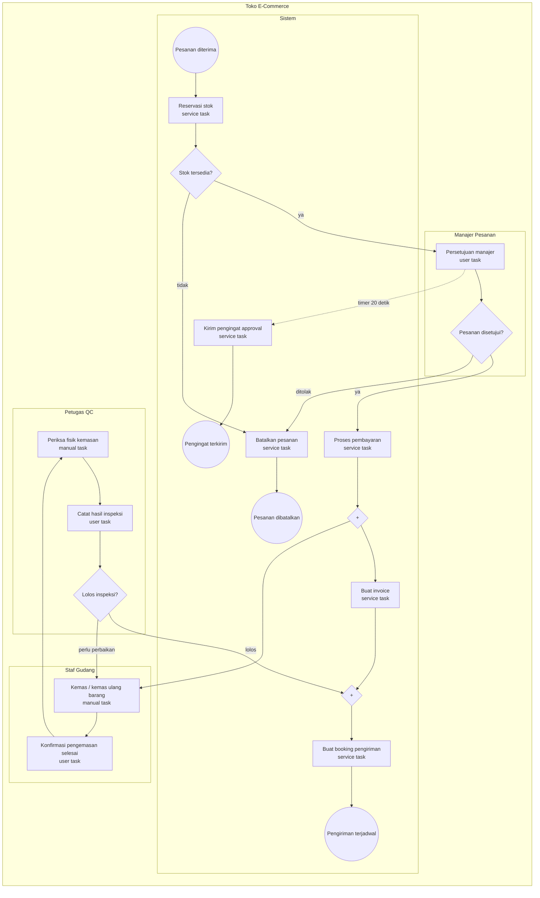

# Tugas Komlay — BPMN E-Commerce Order Fulfillment

Implementasi business process sederhana dengan **BPMN 2.0** yang di-deploy dan
dijalankan di **Camunda 7.24 (Camunda Platform Run)**. Engine, Cockpit, dan
Tasklist berjalan lewat Docker, sedangkan web service task memanggil mock API
lokal.

## Checklist syarat tugas

| Syarat | Implementasi |
|---|---|
| Minimal 5 aktivitas | **11 aktivitas**: 6 service task + 3 user task + 2 manual task |
| Web service task | `Reservasi stok`, `Proses pembayaran`, `Buat invoice`, `Buat booking pengiriman`, `Batalkan pesanan`, `Kirim pengingat approval` (HTTP connector) |
| Task dengan pelaku manusia | `Persetujuan manajer`, `Konfirmasi pengemasan selesai`, dan `Catat hasil inspeksi` adalah user task; pengemasan dan inspeksi fisik adalah manual task |
| Minimal 1 event | None start event `Pesanan diterima` + timer boundary event `PT20S` |
| Minimal 1 gateway | **5 gateway**: 3 exclusive (stok, persetujuan, kualitas), 2 parallel (split dan join) |
| Pool | `Toko E-Commerce` membungkus seluruh proses |
| Lane | `Sistem`, `Manajer Pesanan`, `Staf Gudang`, `Petugas QC` |
| Deploy & run | `demo.py` men-deploy BPMN dan menjalankan 6 skenario uji di engine |

## Diagram proses



File BPMN: [`ecommerce-order.bpmn`](ecommerce-order.bpmn) — sudah dilengkapi
BPMN DI sehingga langsung tampil sebagai diagram saat dibuka di Camunda
Modeler, Cockpit, atau [bpmn.io](https://bpmn.io).

## Arti aktivitas dan keputusan

- **Persetujuan manajer — User Task:** manajer mengisi form di Tasklist.
  Centang **Setujui pesanan?** untuk menyetujui; tidak dicentang berarti
  menolak. Klik **Complete** untuk mengirim keputusan. Penolakan melepas
  reservasi stok dengan alasan `ditolak-manajer`, lalu mengakhiri pesanan.
- **Kemas / kemas ulang barang — Manual Task:** pekerjaan fisik staf gudang
  di luar aplikasi. Setelah QC gagal, staf memperbaiki kemasan melalui langkah
  yang sama. Camunda melewati simbol ini tanpa menunggu pekerjaan fisik.
- **Konfirmasi pengemasan selesai — User Task:** staf mencatat bahwa pengemasan
  atau perbaikan selesai dan siap diperiksa QC. Klik **Complete** hanya setelah
  pekerjaan fisik selesai; task baru muncul pada setiap putaran rework.
- **Periksa fisik kemasan — Manual Task:** petugas QC memeriksa kondisi kemasan
  dan kesiapan kirim di luar aplikasi. Camunda tidak mendeteksi pekerjaan fisik.
- **Catat hasil inspeksi — User Task:** setelah memeriksa kemasan, centang
  **Inspeksi lulus?** jika layak dikirim. Jika tidak dicentang, **Complete**
  mengembalikan pekerjaan ke gudang. Pengemasan, konfirmasi, dan inspeksi
  diulang sampai lolos, tanpa batas putaran atau eskalasi supervisor.
- **Buat invoice — Service Task:** berjalan di cabang paralel di luar loop
  rework. Parallel join menunggu invoice dan QC yang lolos; pembayaran dan
  invoice tidak diulang ketika kemasan diperbaiki.
- **Pengiriman terjadwal — End Event:** berarti booking pengiriman selesai,
  bukan bukti paket sudah dikirim atau diterima pelanggan.

Jalur stok habis dan penolakan manajer melewati blok paralel. Keduanya berakhir
sebagai `Pesanan dibatalkan` tanpa menagih pembayaran atau membuat invoice.

## Pool dan lane

Pool **Toko E-Commerce** mewakili peserta proses secara keseluruhan. Empat
lane membagi tanggung jawab di dalamnya:

| Lane | Tanggung jawab |
|---|---|
| Sistem | Seluruh service task, gateway stok, kedua parallel gateway, serta start/end events |
| Manajer Pesanan | Persetujuan/penolakan dan gateway keputusan; boundary timer tetap melekat pada task manajer |
| Staf Gudang | Pengemasan, pengemasan ulang, dan konfirmasi selesai |
| Petugas QC | Inspeksi fisik, pencatatan hasil, dan keputusan lolos/perbaikan |

Alur antarlane tetap berupa sequence flow dalam satu proses. Jalur QC gagal
kembali dari lane Petugas QC ke Staf Gudang, lalu masuk QC lagi setelah
konfirmasi pengemasan baru. Lane menunjukkan tanggung jawab; untuk simulasi,
akun `demo` dapat menjalankan semua peran tersebut.

## Struktur file

```
ecommerce-order.bpmn   Model proses + diagram
mock_service.py        Mock web service (inventory, payment, invoice, shipment, notification)
docker-compose.yml     Camunda Run + mock API
demo.py                Deploy + jalankan 6 skenario uji end-to-end
userlib/               HTTP connector Camunda (diunduh otomatis bila belum ada)
```

## Cara menjalankan

Prasyarat: Docker (dengan Compose) dan Python 3. Tidak perlu install Camunda
secara manual — image Docker yang dipakai.

Untuk menjalankan satu instance melalui Tasklist:

```bash
python3 demo.py --interactive
```

Script menyalakan stack bila diperlukan, men-deploy model terbaru, lalu
mencetak business key serta tautan langsung ke instance di Cockpit dan task
persetujuan di Tasklist. Login dengan **`demo` / `demo`**. Script berhenti dan
membiarkan instance tetap aktif:

1. Pada tab **Form** task `Persetujuan manajer`, centang pilihan persetujuan
   lalu klik **Complete**, atau biarkan tidak dicentang untuk menolak.
2. Jika disetujui, invoice disiapkan otomatis. Kemas barang secara fisik,
   lalu selesaikan `Konfirmasi pengemasan selesai` di Tasklist.
3. Petugas QC memeriksa fisik kemasan, lalu membuka `Catat hasil inspeksi`.
   Centang **Inspeksi lulus?** dan klik **Complete** jika kemasan layak dikirim.
4. Jika QC tidak lolos, biarkan pilihan tidak dicentang lalu klik **Complete**.
   Kembali ke task konfirmasi gudang yang baru setelah kemasan diperbaiki,
   kemudian lakukan inspeksi ulang sampai lolos.
5. Setelah invoice selesai dan QC lolos, booking pengiriman berjalan.
   Pantau perpindahan antarperan dan loop rework melalui Cockpit.

Untuk menjalankan pengujian otomatis:

```bash
python3 demo.py
```

Script akan:

1. Mengunduh `camunda-connect-connectors-all-7.24.0.jar` bila belum ada.
2. Menjalankan Camunda Run di `http://localhost:8080` dan mock API di `:18081`.
3. Men-deploy `ecommerce-order.bpmn` lewat REST API.
4. Menjalankan enam skenario dan memverifikasi hasilnya. Script mensimulasikan
   keputusan manusia, pengemasan fisik, konfirmasi, dan inspeksi; setiap instance
   uji diselesaikan setelah hasil yang diharapkan tercapai.

Bila Camunda dan mock API sudah siap, langkah 1–2 dilewati. Script memeriksa
identitas mock API lewat `/health` agar tidak salah menghubungi aplikasi lain.
Port host mock API adalah `18081`; komunikasi antarkontainer tetap memakai
`http://mock-api:8081` seperti yang tertera pada BPMN.

Jika port host tersebut sudah dipakai, pilih port kosong dengan variabel yang
sama untuk Compose dan demo:

```bash
export MOCK_API_PORT=18082
python3 demo.py
```

`docker compose up -d` hanya menyalakan layanan; perintah tersebut tidak
men-deploy BPMN atau memulai pesanan. Mode pengujian otomatis menyelesaikan
instance ujinya; gunakan `--interactive` jika ingin melihat instance aktif.

Untuk menghentikan stack:

```bash
docker compose down
```

### Akses UI

| UI | URL | Login |
|---|---|---|
| Cockpit (monitor proses) | http://localhost:8080/camunda/app/cockpit | `demo` / `demo` |
| Tasklist (user task) | http://localhost:8080/camunda/app/tasklist | `demo` / `demo` |
| REST API | http://localhost:8080/engine-rest | tanpa auth |
| Mock API | http://localhost:18081/calls | — |

Di Tasklist, buka filter **All tasks** dan pilih business key yang dicetak
script. Ketiga user task default ditugaskan ke **`demo`**, sehingga tombol
**Complete** tersedia setelah login dengan akun tersebut. Tombol berada pada
tab **Form**; Cockpit digunakan untuk memantau proses.

Untuk akun peran yang terpisah, buat pengguna Camunda terlebih dahulu lalu isi
variabel String `managerUser`, `warehouseUser`, dan `inspectorUser` saat memulai
instance melalui REST API, atau lewat parameter `manager_user`,
`warehouse_user`, dan `inspector_user` pada helper `start_order`. Jika tidak
diberikan, semua peran memakai `demo`.

## Skenario pengujian

`demo.py` memulai instance langsung lewat process key `Process_EcommerceOrder`
dengan **none start event** (lingkaran kosong).

| # | Masukan | Alur dan hasil yang diverifikasi |
|---|---|---|
| 1 | `stockAvailable=true`, `approved=true`, QC langsung lolos | Invoice selesai, join menunggu konfirmasi dan QC. Booking hanya berjalan setelah QC lolos. |
| 2 | `stockAvailable=true`, `approved=false` | Reservasi dilepas dengan alasan `ditolak-manajer`; tidak ada pembayaran, invoice, booking, atau user task tersisa. |
| 3 | `stockAvailable=false` | Reservasi dilepas dengan alasan `stok-habis`; tidak ada pembayaran, invoice, atau booking. |
| 4 | Tunggu timer sebelum menyetujui | Pengingat selesai, persetujuan tetap aktif; setelah persetujuan, pengemasan dan QC, pengiriman terjadwal. |
| 5 | Hasil QC: gagal → lolos | Satu rework, dua task konfirmasi dan dua task QC yang berbeda. Booking tertahan selama gagal. |
| 6 | Hasil QC: gagal → gagal → lolos | Dua rework tanpa eskalasi, tiga task konfirmasi dan tiga task QC. Pembayaran/invoice masing-masing sekali, booking sekali setelah lolos. |

Form persetujuan menyimpan Boolean `approved`, dengan nilai awal `false`.
Form QC menyimpan Boolean `qualityPassed`, juga dengan nilai awal `false`.
Execution listener mereset `qualityPassed=false` setiap task pencatatan QC
baru dimulai, sehingga nilai lama tidak otomatis meloloskan inspeksi berikutnya.
Nilai yang tidak diberikan tidak dianggap sebagai persetujuan atau kelulusan.

Pada pengujian rework, script sengaja menyuntikkan nilai lama `true` sebelum
QC berikutnya, lalu memastikan form baru kembali ke `false`. History aktivitas
diperiksa untuk memastikan manual task, konfirmasi, dan QC dijalankan kembali
pada setiap putaran. Pembayaran, invoice, dan booking harus masing-masing
dipanggil tepat satu kali pada instance yang akhirnya berhasil.

Contoh bagian hasil pengujian:

```text
[i] Putaran 1: demo mensimulasikan inspeksi fisik; hasil=perlu perbaikan.
[✓] User task selesai: Catat hasil inspeksi (UserTask_QualityInspection)
[✓] QC gagal: kembali ke gudang, booking tetap tertahan.
[i] Putaran 2: demo mensimulasikan pengemasan fisik telah selesai.
[✓] User task selesai: Konfirmasi pengemasan selesai (UserTask_WarehouseConfirmation)
[i] Putaran 2: demo mensimulasikan inspeksi fisik; hasil=lolos.
[✓] User task selesai: Catat hasil inspeksi (UserTask_QualityInspection)
=== SEMUA SKENARIO LULUS ===
```

## API invoice

`POST /invoice/create` menerima JSON `orderId` dan `amount`. Dari host, gunakan
`http://localhost:18081/invoice/create` (atau port `MOCK_API_PORT`). Dari Camunda,
connector memakai `http://mock-api:8081/invoice/create`.

```json
{"orderId": "ORD-001", "amount": 150000}
```

Respons mock sukses bersifat deterministik:

```json
{"ok": true, "service": "mock-api", "orderId": "ORD-001", "invoiceId": "INV-ORD-001", "amount": 150000}
```

Connector menyimpan JSON respons sebagai String `invoiceResponse`. Payload yang
tidak menyertakan `orderId` atau `amount` mendapat HTTP 400. Integrasi ini adalah
mock untuk demonstrasi; model belum menambahkan jalur kegagalan pembayaran,
refund, eskalasi QC, atau pelacakan penerimaan barang.

## Detail teknis

- **Web service task** memakai `http-connector` bawaan Camunda. Connector
  disediakan lewat `configuration/userlib` (di-mount oleh `docker-compose.yml`),
  karena image Camunda Run tidak membundelnya.
- **Mock web service** dibuat dengan `http.server` (Python stdlib) agar demo
  tidak bergantung pada API eksternal. Setiap request dicatat dan bisa dilihat
  di `GET http://localhost:18081/calls` (atau port `MOCK_API_PORT` yang dipilih).
- **Timer** diset `PT20S` agar mudah didemokan; untuk produksi ubah
  `timeDuration` menjadi misalnya `PT1H`. Timer bersifat *non-interrupting*,
  jadi task approval tidak batal saat pengingat dikirim.
- **History time to live** diset 30 hari (`camunda:historyTimeToLive="30"`)
  karena Camunda 7.20+ mewajibkannya.
- **Versi proses**: deploy membuat versi definisi baru dengan process key yang
  sama. Instance yang sudah berjalan tetap memakai versi asal; script tidak
  memigrasikan instance lama.
- **Modeler**: buka `ecommerce-order.bpmn` di
  [Camunda Modeler](https://camunda.com/download/modeler/) (desktop) atau
  [bpmn.io](https://bpmn.io) (web). Tidak ada dependensi khusus saat membuka
  file.

## Mengganti mock dengan web service nyata

Ubah nilai `url` pada `camunda:inputParameter` di setiap service task, misalnya:

```xml
<camunda:inputParameter name="url">https://api.perusahaan.com/inventory/reserve</camunda:inputParameter>
```

Lalu deploy ulang dengan `python3 demo.py` atau lewat REST API:

```bash
curl -X POST http://localhost:8080/engine-rest/deployment/create \
  -F "deployment-name=ecommerce" \
  -F "ecommerce-order.bpmn=@ecommerce-order.bpmn;type=application/xml"
```
