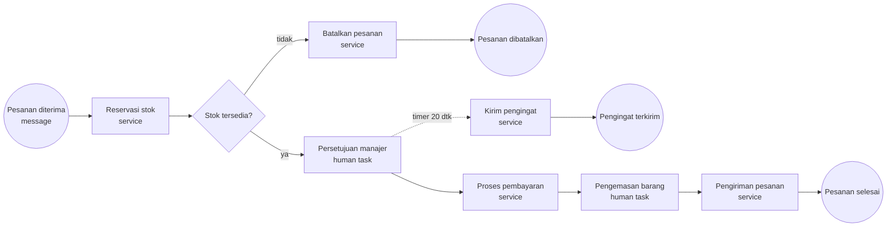

# Tugas Komlay — BPMN E-Commerce Order Fulfillment

Implementasi business process sederhana dengan **BPMN 2.0** yang di-deploy dan
dijalankan di **Camunda 7.24 (Camunda Platform Run)**. Engine, Cockpit, dan
Tasklist berjalan lewat Docker, sedangkan web service task memanggil mock API
lokal.

## Checklist syarat tugas

| Syarat | Implementasi |
|---|---|
| Minimal 5 aktivitas | **7 aktivitas**: 5 service task + 2 human task |
| Web service task | `Reservasi stok`, `Proses pembayaran`, `Pengiriman pesanan`, `Batalkan pesanan`, `Kirim pengingat approval` (HTTP connector) |
| Human task | `Persetujuan manajer` (assignee `manager`), `Pengemasan barang` (assignee `warehouse`) |
| Minimal 1 event | Message start event `orderPlaced` + timer boundary event `PT20S` |
| Minimal 1 gateway | Exclusive gateway `Stok tersedia?` dengan dua jalur |
| Deploy & run | `demo.py` men-deploy BPMN dan menjalankan 3 skenario uji di engine |

## Diagram proses



File BPMN: [`ecommerce-order.bpmn`](ecommerce-order.bpmn) — sudah dilengkapi
BPMN DI sehingga langsung tampil sebagai diagram saat dibuka di Camunda
Modeler, Cockpit, atau [bpmn.io](https://bpmn.io).

## Struktur file

```
ecommerce-order.bpmn   Model proses + diagram
mock_service.py        Mock web service (inventory, payment, shipment, notification)
docker-compose.yml     Camunda Run + mock API
demo.py                Deploy + jalankan 3 skenario uji end-to-end
userlib/               HTTP connector Camunda (diunduh otomatis bila belum ada)
```

## Cara menjalankan

Prasyarat: Docker (dengan Compose) dan Python 3. Tidak perlu install Camunda
secara manual — image Docker yang dipakai.

```bash
python3 demo.py
```

Script akan:

1. Mengunduh `camunda-connect-connectors-all-7.24.0.jar` bila belum ada.
2. Menjalankan Camunda Run di `http://localhost:8080` dan mock API di `:8081`.
3. Men-deploy `ecommerce-order.bpmn` lewat REST API.
4. Menjalankan tiga skenario dan memverifikasi hasilnya.

Bila Camunda sudah berjalan, langkah 1–2 dilewati. Untuk menghentikan stack:

```bash
docker compose down
```

### Akses UI

| UI | URL | Login |
|---|---|---|
| Cockpit (monitor proses) | http://localhost:8080/camunda/app/cockpit | `demo` / `demo` |
| Tasklist (human task) | http://localhost:8080/camunda/app/tasklist | `demo` / `demo` |
| REST API | http://localhost:8080/engine-rest | tanpa auth |
| Mock API | http://localhost:8081/calls | — |

Di Tasklist, buka filter **All tasks** untuk melihat `Persetujuan manajer`
(assignee `manager`) dan `Pengemasan barang` (assignee `warehouse`).

## Skenario pengujian

`demo.py` memulai instance lewat **message start event** `orderPlaced`, bukan
langsung lewat process key.

| # | Variabel | Alur yang diuji | Hasil yang diverifikasi |
|---|---|---|---|
| 1 | `stockAvailable=true` | reservasi → approval → pembayaran → pengemasan → pengiriman | `EndEvent_Completed`, 3 panggilan web service |
| 2 | `stockAvailable=false` | gateway memilih jalur pembatalan | `EndEvent_Cancelled`, panggilan `release` stok |
| 3 | `stockAvailable=true`, tunggu timer | boundary timer 20 detik | `EndEvent_ReminderSent`, task approval tetap aktif (non-interrupting), lalu proses utama selesai |

Contoh hasil verifikasi:

```
[✓] Deploy berhasil: Process_EcommerceOrder:1:... (v1)
=== Skenario 1: stok tersedia, pesanan diproses penuh ===
[✓] Human task selesai: Persetujuan manajer (UserTask_ManagerApproval)
[✓] Human task selesai: Pengemasan barang (UserTask_WarehousePacking)
[✓] Web service terpanggil: /inventory/reserve, /payment/charge, /shipment/book
[✓] Pesanan ORD-...-A selesai (EndEvent_Completed)
=== Skenario 2: stok habis, gateway membatalkan pesanan ===
[✓] Pesanan ORD-...-B dibatalkan (EndEvent_Cancelled)
=== Skenario 3: timer 20 detik mengirim pengingat approval ===
[✓] Pengingat terkirim, task approval tetap aktif (non-interrupting)
=== SEMUA SKENARIO LULUS ===
```

## Detail teknis

- **Web service task** memakai `http-connector` bawaan Camunda. Connector
  disediakan lewat `configuration/userlib` (di-mount oleh `docker-compose.yml`),
  karena image Camunda Run tidak membundelnya.
- **Mock web service** dibuat dengan `http.server` (Python stdlib) agar demo
  tidak bergantung pada API eksternal. Setiap request dicatat dan bisa dilihat
  di `GET http://localhost:8081/calls`.
- **Timer** diset `PT20S` agar mudah didemokan; untuk produksi ubah
  `timeDuration` menjadi misalnya `PT1H`. Timer bersifat *non-interrupting*,
  jadi task approval tidak batal saat pengingat dikirim.
- **History time to live** diset 30 hari (`camunda:historyTimeToLive="30"`)
  karena Camunda 7.20+ mewajibkannya.
- **Modeler**: buka `ecommerce-order.bpmn` di
  [Camunda Modeler](https://camunda.com/download/modeler/) (desktop) atau
  [bpmn.io](https://bpmn.io) (web). Tidak ada dependensi khusus saat membuka
  file.

## Mengganti mock dengan web service nyata

Ubah nilai `url` pada `camunda:inputParameter` di setiap service task, misalnya:

```xml
<camunda:inputParameter name="url">https://api.perusahaan.com/inventory/reserve</camunda:inputParameter>
```

Lalu deploy ulang dengan `python3 demo.py` atau lewat REST API:

```bash
curl -X POST http://localhost:8080/engine-rest/deployment/create \
  -F "deployment-name=ecommerce" \
  -F "ecommerce-order.bpmn=@ecommerce-order.bpmn;type=application/xml"
```
